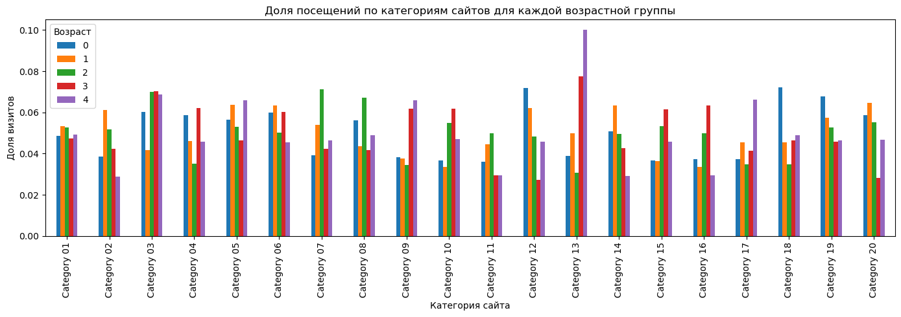
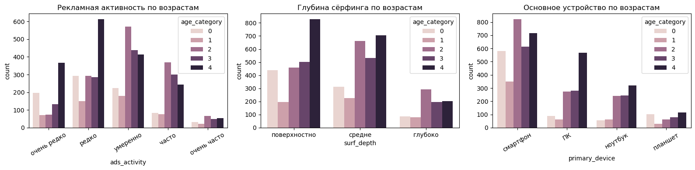
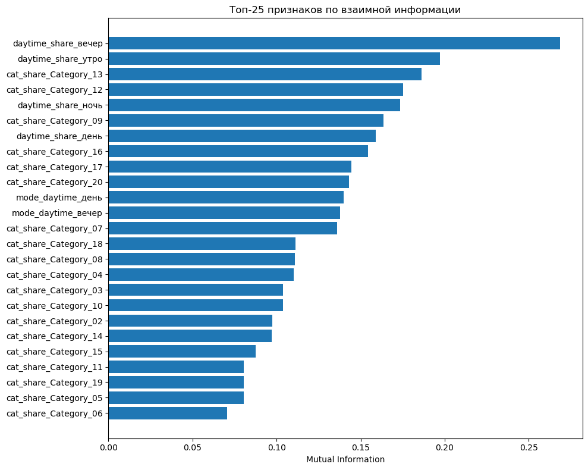
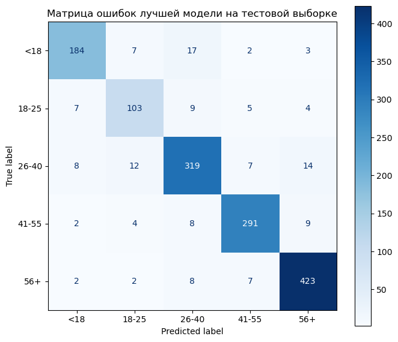

# Предсказание возраста пользователя по поведению в интернете

[](https://github.com/henwrr/user_age_prediction/actions/workflows/tests.yml)


Модель определяет возрастную группу анонимного пользователя по его цифровому следу: какие сайты он посещает, в какое время суток, с какого устройства и как реагирует на рекламу.

| Метрика | Значение |
|---|---|
| F1-macro, кросс-валидация (5 фолдов) | **0.902** |
| F1-macro, отложенная выборка | **0.890** |
| Accuracy, отложенная выборка | 0.91 |
| Целевой порог бизнеса | 0.75 ✅ |

## Задача

Интернет-сервисы компании «Йети» хотят персонализировать контент и рекламу, но возраст большинства пользователей неизвестен. Нужно по поведению предсказать одну из 5 категорий:

| Класс | Возраст | Доля |
|:-:|---|---|
| 0 | < 18 | 15 % |
| 1 | 18–25 | 9 % |
| 2 | 26–40 | 25 % |
| 3 | 41–55 | 22 % |
| 4 | 56+ | 30 % |

Классы несбалансированы, а ошибка на любой группе одинаково неприятна для бизнеса, поэтому основная метрика — **F1-macro**.

## Данные

5 826 пользователей, около 1,05 млн визитов за 14 дней, 6 таблиц, связанных по `user_id`. Это учебный датасет Яндекс Практикума, категории сайтов анонимизированы. CSV в репозиторий не входят: код скачивает их из публичного хранилища.

| Таблица | Содержимое |
|---|---|
| `ds_s13_users.csv` | `user_id`, целевая `age_category` |
| `ds_s13_visits.csv` | лог визитов: дата, время суток, сессия, категория сайта |
| `ads_activity.csv` | рекламная активность (CTR, 5 уровней) |
| `surf_depth.csv` | глубина сёрфинга |
| `primary_device.csv` | основное устройство |
| `cloud_usage.csv` | пользуется ли облаком |

## Ключевые находки EDA

**У каждой возрастной группы свои «любимые» сайты.** Например, Category 13 — это 10 % всех визитов пользователей 56+, а подростки чаще всех заходят в Category 12 и 18.



**Устройство, глубина сёрфинга и реклама тоже различаются.** У подростков около 70 % пользуются в основном смартфоном, у 56+ заметно выше доля ПК. Активнее всех кликают по рекламе группы 26–55, а подростки и 56+ — реже всех.



## Признаки

Функция [`build_features`](src/features.py) превращает сырые логи в 34 признака на пользователя:

- **20 долей визитов по категориям сайтов** — профиль интересов;
- **4 доли активности по времени суток** + модальное время суток — режим дня;
- **5 признаков интенсивности:** сессии в день, всего сессий, активные дни, число визитов, число разных категорий;
- **4 профильных признака:** рекламная активность, глубина сёрфинга, устройство, облако.

Самые информативные признаки по mutual information — **доли вечерней и утренней активности**, следом идут доли категорий 13 и 12. Режим дня выдаёт возраст сильнее всего остального.



## Моделирование

- Стратифицированный сплит 75/25, `StratifiedKFold` на 5 фолдов, подбор через `GridSearchCV`.
- Вся предобработка (импутация, `StandardScaler`, `OneHotEncoder`) — внутри `Pipeline`, утечки данных нет.

| Модель | F1-macro (CV) |
|---|---|
| DummyClassifier (самый частый класс) | 0.093 |
| LinearSVC (C=0.1) | 0.796 |
| LogisticRegression (C=0.1) | 0.820 |
| SVC, RBF-ядро (C=1, gamma=scale) | 0.892 |
| **SVC, полиномиальное ядро (C=1, degree=2)** | **0.902** |

Нелинейные ядра обгоняют линейные модели на 0.08–0.11: связь поведения с возрастом нелинейна. Полиномиальное ядро 2-й степени явно моделирует попарные взаимодействия признаков (например, «вечерняя активность × категория сайта»), поэтому оно лучшее.

## Качество на отложенной выборке

| Класс | Precision | Recall | F1 |
|---|---|---|---|
| < 18 | 0.91 | 0.86 | 0.88 |
| 18–25 | 0.80 | 0.80 | 0.80 |
| 26–40 | 0.88 | 0.89 | 0.88 |
| 41–55 | 0.93 | 0.93 | 0.93 |
| 56+ | 0.93 | 0.96 | 0.95 |



Хуже всего распознаётся самая маленькая группа 18–25. Ошибки модель чаще всего «стягивает» к крупным классам 26–40 и 56+: например, 17 подростков отнесены к 26–40, а 14 человек 26–40 — к 56+.

## Структура проекта

```
user_age_prediction/
├── notebooks/
│   └── user_age_prediction.ipynb   # исследование: EDA, отбор признаков, сравнение моделей
├── src/
│   ├── config.py                   # константы и лучшие гиперпараметры
│   ├── data.py                     # загрузка таблиц (локально или из S3)
│   ├── features.py                 # build_features: логи -> 34 признака
│   ├── pipeline.py                 # предобработка + SVC
│   ├── train.py                    # CLI обучения
│   └── predict.py                  # CLI предсказания
├── tests/                          # pytest: признаки и пайплайн
├── images/                         # графики для README
├── Makefile
└── requirements.txt
```

## Запуск

```bash
git clone https://github.com/henwrr/user_age_prediction.git
cd user_age_prediction
pip install -r requirements.txt
```

**Обучить модель** (данные скачаются автоматически, модель сохранится в `models/`):

```bash
python -m src.train
```

**Получить предсказания** для новых пользователей. В папке должны лежать CSV с теми же именами, колонка `age_category` не нужна:

```bash
python -m src.predict --data-dir data/ --output predictions.csv
```

```
user_id,age_category,age_label
f545-8c95aefe8d3e5548a689-a5b2fd39,4,56+
cb48-5a0d6cde4d86ae10637e-c8ceb6ed,2,26-40
```

**Тесты:**

```bash
pytest -q
```

## Что можно улучшить

- Попробовать градиентный бустинг (CatBoost / LightGBM) и стекинг с SVC.
- Добавить признаки последовательностей: переходы между категориями внутри сессии, активность по дням недели.
- Подобрать веса классов, чтобы поднять recall для 18–25.
- Обернуть инференс в FastAPI-сервис с Docker.

## Стек

Python · pandas · NumPy · scikit-learn · matplotlib · seaborn · pytest · GitHub Actions
